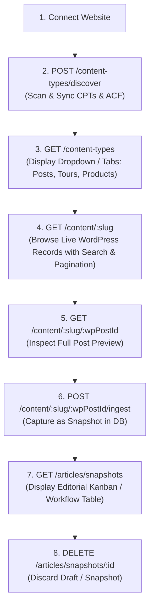

# WordPress Automation Platform - Frontend API Integration Guide

This guide covers the **Content Type Discovery**, **Live WordPress Content Browsing**, **Snapshot Ingestion**, and **Workflow Snapshot Management** REST APIs. Use this documentation to build the frontend user interface.

---

## 1. Architecture & Authentication

### Base URL & Global Prefix
All endpoints are prefixed with the global API version:
```http
{{baseUrl}} = http://localhost:3000/api/v1
```

### Authorization Header
All endpoints in this guide require a valid JSON Web Token (JWT) retrieved from `POST /auth/login`:
```http
Authorization: Bearer <accessToken>
```

### Standard Response Envelope
All successful responses are wrapped in a standard JSON envelope:
```json
{
  "success": true,
  "statusCode": 200,
  "message": "Human readable status message",
  "data": { ... },
  "meta": {
    "timestamp": "2026-11-25T04:30:00.000Z",
    "path": "/api/v1/..."
  }
}
```

---

## 2. Frontend User Workflow



---

## 3. API Summary Table

| Method | Endpoint | Description | Frontend Use Case |
| :--- | :--- | :--- | :--- |
| `POST` | `/websites/:websiteId/content-types/discover` | Scans WordPress for all CPTs, taxonomies & ACF fields | "Sync Site Schema" / Refresh button |
| `GET` | `/websites/:websiteId/content-types` | Lists all discovered active content types for the site | Content type switcher / navigation tabs |
| `GET` | `/websites/:websiteId/content-types/:slug` | Retrieves schema, ACF fields, and taxonomies for a CPT | Schema inspector / form generator |
| `GET` | `/websites/:websiteId/content/:contentTypeSlug` | Lists live WP posts with pagination & search | Content table / live post browser |
| `GET` | `/websites/:websiteId/content/:contentTypeSlug?search=:q` | Searches live WP posts by keyword | Live search bar above post table |
| `GET` | `/websites/:websiteId/content/:contentTypeSlug/:wpPostId` | Fetches a single full live post from WordPress | "Preview Live Post" modal / drawer |
| `POST` | `/websites/:websiteId/content/:contentTypeSlug/:wpPostId/ingest` | Ingests live WP post into DB as an editable snapshot | "Import to Workflow" / "Enhance with AI" button |
| `GET` | `/articles/snapshots` | Lists all ingested snapshots across sites with pagination | Main Editorial Dashboard / Kanban view |
| `GET` | `/articles/snapshots?workflowStatus=IMPORTED` | Filters snapshots by editorial status | Filter tabs (Drafts, In Review, Ready) |
| `GET` | `/articles/snapshots/:snapshotId` | Retrieves single snapshot details by UUID | Article editor / review screen |
| `DELETE` | `/articles/snapshots/:snapshotId` | Deletes a content snapshot from workflow | "Discard" / "Delete Snapshot" button |

---

## 4. Detailed Endpoint Specifications

### 4.1. Discover & Sync Content Types
Scans the live WordPress site via REST API, registers all public Custom Post Types (CPTs), ACF field groups, and taxonomies (Categories, Tags), and saves them to the database.

* **Method:** `POST`
* **Route:** `/websites/:websiteId/content-types/discover`
* **Permissions:** `SUPER_ADMIN`, `ADMIN`, `EDITOR`
* **Path Parameters:**
  * `websiteId` *(UUID)*: The unique ID of the website.
* **Request Body:** None.
* **Success Response (`200 OK`):**
```json
{
  "success": true,
  "statusCode": 200,
  "message": "Content types discovered and registered successfully",
  "data": [
    {
      "id": "7b8e19e0-8bc2-4c25-bb3e-790184c8a2b1",
      "websiteId": "4b2999a0-4498-4457-b4f6-8151c558c8a6",
      "slug": "post",
      "name": "Posts",
      "description": "Standard blog articles",
      "restNamespace": "wp/v2",
      "restBase": "posts",
      "hierarchical": false,
      "taxonomies": ["Categories", "Tags"],
      "schemaStatus": "VALID",
      "isActive": true,
      "lastDiscoveredAt": "2026-11-25T04:15:00.000Z"
    },
    {
      "id": "9a1d48c2-3e21-4d33-a621-c7d9183491e0",
      "websiteId": "4b2999a0-4498-4457-b4f6-8151c558c8a6",
      "slug": "tour_package",
      "name": "Tour Packages",
      "description": "Custom travel itineraries",
      "restNamespace": "wp/v2",
      "restBase": "tour_packages",
      "hierarchical": false,
      "taxonomies": ["Destinations", "Trip Types"],
      "schemaStatus": "VALID",
      "isActive": true,
      "lastDiscoveredAt": "2026-11-25T04:15:00.000Z"
    }
  ]
}
```

---

### 4.2. List Registered Content Types
Returns all active content types previously discovered and stored for this website. Fast read from PostgreSQL (does not call external WordPress APIs).

* **Method:** `GET`
* **Route:** `/websites/:websiteId/content-types`
* **Path Parameters:**
  * `websiteId` *(UUID)*: The website ID.
* **Success Response (`200 OK`):**
Returns an array of `ContentTypeSummary` objects (same structure as above).

---

### 4.3. Get Content Type Details & Schema
Fetches schema details for a specific content type, including supported WordPress features (`title`, `editor`, `thumbnail`), available taxonomies, and custom ACF fields.

* **Method:** `GET`
* **Route:** `/websites/:websiteId/content-types/:contentTypeSlug`
* **Path Parameters:**
  * `websiteId` *(UUID)*: The website ID.
  * `contentTypeSlug` *(string)*: The slug of the content type (e.g. `post`, `page`, `tour_package`).
* **Success Response (`200 OK`):**
```json
{
  "success": true,
  "statusCode": 200,
  "message": "Content type details retrieved successfully",
  "data": {
    "id": "9a1d48c2-3e21-4d33-a621-c7d9183491e0",
    "websiteId": "4b2999a0-4498-4457-b4f6-8151c558c8a6",
    "slug": "tour_package",
    "name": "Tour Packages",
    "description": "Custom travel itineraries",
    "restNamespace": "wp/v2",
    "restBase": "tour_packages",
    "hierarchical": false,
    "supports": ["title", "editor", "thumbnail", "custom-fields", "excerpt"],
    "taxonomies": [
      {
        "name": "Destinations",
        "slug": "destination",
        "hierarchical": true
      },
      {
        "name": "Trip Types",
        "slug": "trip_type",
        "hierarchical": false
      }
    ],
    "acfFields": ["price", "duration_days", "itinerary", "included_services"],
    "schemaStatus": "VALID",
    "isActive": true,
    "lastDiscoveredAt": "2026-11-25T04:15:00.000Z"
  }
}
```

---

### 4.4. List Live WordPress Content (Browse, Search & Pagination)
Connects to the live WordPress REST API in real time and retrieves published/draft posts with author names, category tags, and featured images.

* **Method:** `GET`
* **Route:** `/websites/:websiteId/content/:contentTypeSlug`
* **Path Parameters:**
  * `websiteId` *(UUID)*: The website ID.
  * `contentTypeSlug` *(string)*: e.g. `post`, `tour_package`.
* **Query Parameters:**
  * `page` *(number, optional, default: `1`)*: Page number.
  * `limit` *(number, optional, default: `10`, max: `100`)*: Items per page.
  * `search` *(string, optional)*: Keyword query searched against titles and content in WordPress.
  * `status` *(string, optional, default: `any`)*: Post status filter (`publish`, `draft`, `pending`, `future`).
  * `order` *(string, optional, default: `desc`)*: Sort order (`asc` or `desc`).
  * `orderby` *(string, optional, default: `date`)*: Sort field (`date`, `title`, `id`, `modified`).
* **Success Response (`200 OK`):**
```json
{
  "success": true,
  "statusCode": 200,
  "message": "Live content records retrieved successfully",
  "data": {
    "items": [
      {
        "wpPostId": 1042,
        "title": "7 Days Exotic Bali Tour Itinerary",
        "slug": "7-days-exotic-bali-tour",
        "status": "publish",
        "wpUrl": "https://testspace.quicksite.asia/tour_packages/7-days-exotic-bali-tour",
        "featuredImageUrl": "https://testspace.quicksite.asia/wp-content/uploads/2026/11/bali-resort.jpg",
        "publishedAt": "2026-11-20T10:00:00.000Z",
        "modifiedAt": "2026-11-22T14:30:00.000Z",
        "author": {
          "id": 1,
          "name": "itadmin"
        },
        "taxonomies": {
          "destination": ["Indonesia", "Bali"],
          "trip_type": ["Adventure", "Luxury"]
        },
        "customFields": {
          "price": "$1,450",
          "duration_days": 7
        }
      }
    ],
    "pagination": {
      "page": 1,
      "limit": 10,
      "totalItems": 48,
      "totalPages": 5
    }
  }
}
```

---

### 4.5. Get Single Live WordPress Content Item
Fetches complete live data (HTML content, excerpt, all custom ACF fields, raw metadata) for a single post by its WordPress numeric ID.

* **Method:** `GET`
* **Route:** `/websites/:websiteId/content/:contentTypeSlug/:wpPostId`
* **Path Parameters:**
  * `websiteId` *(UUID)*: The website ID.
  * `contentTypeSlug` *(string)*: e.g. `post`.
  * `wpPostId` *(integer)*: WordPress Post ID (e.g. `1042`).
* **Success Response (`200 OK`):**
```json
{
  "success": true,
  "statusCode": 200,
  "message": "Live content item retrieved successfully",
  "data": {
    "wpPostId": 1042,
    "title": "7 Days Exotic Bali Tour Itinerary",
    "slug": "7-days-exotic-bali-tour",
    "status": "publish",
    "contentHtml": "<p>Experience the ultimate tropical getaway with our 7-day tour...</p>",
    "excerpt": "Experience the ultimate tropical getaway...",
    "wpUrl": "https://testspace.quicksite.asia/tour_packages/7-days-exotic-bali-tour",
    "featuredImageUrl": "https://testspace.quicksite.asia/wp-content/uploads/2026/11/bali-resort.jpg",
    "customFields": {
      "price": "$1,450",
      "duration_days": 7,
      "itinerary": "Day 1: Arrival..."
    },
    "taxonomies": {
      "destination": ["Bali"],
      "trip_type": ["Adventure"]
    }
  }
}
```

---

### 4.6. Ingest Live Content into Workflow Snapshot
Imports an existing WordPress post into the PostgreSQL database as a `ContentSnapshot`. This freezes the original content and initiates the AI optimization/editorial workflow without altering the live WordPress post.

* **Method:** `POST`
* **Route:** `/websites/:websiteId/content/:contentTypeSlug/:wpPostId/ingest`
* **Permissions:** `SUPER_ADMIN`, `ADMIN`, `EDITOR`
* **Path Parameters:**
  * `websiteId` *(UUID)*: The website ID.
  * `contentTypeSlug` *(string)*: e.g. `post`.
  * `wpPostId` *(integer)*: e.g. `1042`.
* **Request Body:** None.
* **Success Response (`201 Created`):**
```json
{
  "success": true,
  "statusCode": 201,
  "message": "Content snapshot captured successfully for workflow",
  "data": {
    "id": "e2f7b490-67c2-4824-a10d-8302fbc41703",
    "websiteId": "4b2999a0-4498-4457-b4f6-8151c558c8a6",
    "wpPostId": 1042,
    "slug": "7-days-exotic-bali-tour",
    "title": "7 Days Exotic Bali Tour Itinerary",
    "wpStatus": "publish",
    "wpUrl": "https://testspace.quicksite.asia/tour_packages/7-days-exotic-bali-tour",
    "workflowStatus": "IMPORTED",
    "featuredMediaUrl": "https://testspace.quicksite.asia/wp-content/uploads/2026/11/bali-resort.jpg",
    "customFields": {
      "price": "$1,450",
      "duration_days": 7
    },
    "taxonomiesData": {
      "destination": ["Bali"]
    },
    "createdAt": "2026-11-25T04:32:00.000Z",
    "updatedAt": "2026-11-25T04:32:00.000Z"
  }
}
```

---

### 4.7. List Content Snapshots (With Filters & Pagination)
Retrieves a paginated list of all drafts and snapshots currently managed in the platform across websites. Supports filtering by status, website, or content type.

* **Method:** `GET`
* **Route:** `/articles/snapshots`
* **Query Parameters:**
  * `page` *(number, optional, default: `1`)*: Page number.
  * `limit` *(number, optional, default: `10`, max: `100`)*: Items per page.
  * `workflowStatus` *(enum, optional)*: Filter by status:
    * `IMPORTED`: Ingested or newly created draft.
    * `ENHANCING`: Currently being rewritten/optimized by AI.
    * `READY_FOR_REVIEW`: AI completed, pending user review.
    * `SCHEDULED`: Scheduled for automated publishing.
    * `PUBLISHED`: Successfully pushed to WordPress.
    * `FAILED`: Enhancement or publishing failure.
  * `websiteId` *(UUID, optional)*: Filter snapshots for a specific website.
  * `contentTypeId` *(UUID, optional)*: Filter snapshots for a specific content type.
* **Success Response (`200 OK`):**
```json
{
  "success": true,
  "statusCode": 200,
  "message": "Content snapshots retrieved successfully",
  "data": {
    "items": [
      {
        "id": "04db999d-9f0b-4cbc-845c-576443b6108e",
        "websiteId": "4b2999a0-4498-4457-b4f6-8151c558c8a6",
        "title": "Is Liqui Moly Engine Oil Worth the Price? An Honest Buyer's Guide",
        "slug": "is-liqui-moly-worth-it",
        "focusKeyword": "liqui moly engine oil",
        "metaDescription": "Unbiased review of Liqui Moly engine oil formulas...",
        "workflowStatus": "IMPORTED",
        "wpPostId": null,
        "wpUrl": null,
        "featuredMediaUrl": "https://market-resized.envatousercontent.com/previews/files/263007148/Image-preview-590x590px.jpg",
        "website": {
          "name": "testspace.quicksite",
          "url": "https://testspace.quicksite.asia"
        },
        "contentType": {
          "name": "Posts",
          "slug": "post"
        },
        "createdAt": "2026-11-25T03:33:24.000Z",
        "updatedAt": "2026-11-25T03:33:24.000Z"
      }
    ],
    "pagination": {
      "page": 1,
      "limit": 10,
      "totalItems": 1,
      "totalPages": 1
    }
  }
}
```

---

### 4.8. Get Snapshot Details by ID
Returns the complete content snapshot, including the raw text document, structured HTML body, SEO metadata, attached Envato image placeholders, and WordPress taxonomies.

* **Method:** `GET`
* **Route:** `/articles/snapshots/:id`
* **Path Parameters:**
  * `id` *(UUID)*: The snapshot ID.
* **Success Response (`200 OK`):**
```json
{
  "success": true,
  "statusCode": 200,
  "message": "Content snapshot details retrieved successfully",
  "data": {
    "id": "04db999d-9f0b-4cbc-845c-576443b6108e",
    "websiteId": "4b2999a0-4498-4457-b4f6-8151c558c8a6",
    "title": "Is Liqui Moly Engine Oil Worth the Price? An Honest Buyer's Guide",
    "slug": "is-liqui-moly-worth-it",
    "focusKeyword": "liqui moly engine oil",
    "metaDescription": "Unbiased review of Liqui Moly engine oil formulas...",
    "contentHtml": "<p>When car owners ask whether premium engine oil is worth it...</p><h2>What Makes German Lubricants Different?</h2><p>...</p>",
    "workflowStatus": "IMPORTED",
    "mediaPlaceholders": [
      {
        "placeholderId": "hero_featured",
        "position": "featured_hero",
        "recommendedSearch": "motor oil",
        "fallbackSearch": "car engine",
        "altText": "Bottles of premium synthetic motor oil in auto garage",
        "selectedAsset": {
          "id": "21827684",
          "title": "Motor Oil Set Mockup",
          "previewUrl": "https://market-resized.envatousercontent.com/previews/files/263007148/Image-preview-590x590px.jpg",
          "downloadUrl": "https://market-resized.envatousercontent.com/previews/files/263007148/Image-preview-590x590px.jpg",
          "provider": "envato"
        },
        "alternativeOptions": []
      }
    ],
    "taxonomiesData": {
      "categorySlugs": ["automotive"],
      "tagSlugs": ["engine-oil", "car-maintenance"]
    },
    "customFields": {},
    "createdAt": "2026-11-25T03:33:24.000Z",
    "updatedAt": "2026-11-25T03:33:24.000Z"
  }
}
```

---

### 4.9. Delete Snapshot
Permanently deletes a draft snapshot from the database. (Does not affect any live WordPress post).

* **Method:** `DELETE`
* **Route:** `/articles/snapshots/:id`
* **Permissions:** `SUPER_ADMIN`, `ADMIN`
* **Path Parameters:**
  * `id` *(UUID)*: The snapshot ID.
* **Success Response (`200 OK`):**
```json
{
  "success": true,
  "statusCode": 200,
  "message": "Content snapshot removed from workflow",
  "data": {
    "deleted": true,
    "id": "04db999d-9f0b-4cbc-845c-576443b6108e"
  }
}
```

---

## 5. TypeScript Interfaces for Frontend Codebases

Save these type definitions in your frontend application (e.g., `src/types/content.ts`):

```typescript
export type WorkflowStatus =
  | 'IMPORTED'
  | 'ENHANCING'
  | 'READY_FOR_REVIEW'
  | 'SCHEDULED'
  | 'PUBLISHED'
  | 'FAILED';

export interface ContentTypeSummary {
  id: string;
  websiteId: string;
  slug: string;
  name: string;
  description?: string;
  restNamespace: string;
  restBase: string;
  hierarchical: boolean;
  taxonomies: string[];
  schemaStatus: 'VALID' | 'STALE' | 'ERROR';
  isActive: boolean;
  lastDiscoveredAt: string;
}

export interface ContentTypeDetails extends ContentTypeSummary {
  supports: string[];
  taxonomies: Array<{
    name: string;
    slug: string;
    hierarchical: boolean;
  }>;
  acfFields: string[];
}

export interface LiveContentItem {
  wpPostId: number;
  title: string;
  slug: string;
  status: string;
  wpUrl: string;
  featuredImageUrl?: string;
  publishedAt: string;
  modifiedAt: string;
  author: {
    id: number;
    name: string;
  };
  taxonomies: Record<string, string[]>;
  customFields: Record<string, any>;
}

export interface ContentSnapshot {
  id: string;
  websiteId: string;
  wpPostId?: number | null;
  slug?: string | null;
  title?: string | null;
  focusKeyword?: string | null;
  metaDescription?: string | null;
  contentHtml?: string | null;
  workflowStatus: WorkflowStatus;
  wpUrl?: string | null;
  featuredMediaUrl?: string | null;
  mediaPlaceholders?: Array<{
    placeholderId: string;
    position: string;
    recommendedSearch: string;
    altText: string;
    selectedAsset: {
      id: string;
      title: string;
      previewUrl: string;
      downloadUrl: string;
      provider: string;
    };
    alternativeOptions: any[];
  }>;
  taxonomiesData?: Record<string, any>;
  customFields?: Record<string, any>;
  createdAt: string;
  updatedAt: string;
}
```

---

## 12. Manual Envato Media Workflow (Upload, Select, Re-Search & Publish Guard)

Because Envato Elements subscriptions do not provide a public download API, each placeholder in `images` now includes:
- `elementsSearchUrl`: Direct link to search Envato Elements (`https://elements.envato.com/photos/...`)
- `isPreviewOnly`: `true` while using an Envato preview URL; flips to `false` once replaced with a licensed upload

### A. Upload Licensed Image for a Placeholder
**`POST /api/v1/websites/:websiteId/articles/:id/media`** (`multipart/form-data`)
- `file`: The image file downloaded from Envato Elements
- `placeholderId`: Target placeholder ID (e.g. `featured_hero`, `after_h2_1`)

Uploads directly to WordPress Media Library, swaps the preview URL in `featuredMediaUrl` and `contentHtml`, and sets `isPreviewOnly: false`.

### B. Select an Alternative Returned Thumbnail
**`PATCH /api/v1/websites/:websiteId/articles/:id/media/select`**
```json
{ "placeholderId": "featured_hero", "assetId": "123456" }
```

### C. Re-Search Envato with a Custom Keyword
**`POST /api/v1/websites/:websiteId/articles/:id/media/search`**
```json
{ "placeholderId": "featured_hero", "query": "bali beach resort" }
```

### D. Preview Image Publish Guard
**`POST /api/v1/websites/:websiteId/articles/:id/publish`**
- When `"status": "publish"`, the backend blocks publishing with `400 Bad Request` if any placeholder still has `isPreviewOnly: true`, returning `previewPlaceholders` with their `elementsSearchUrl`.
- Pass `{ "status": "publish", "allowPreviewImages": true }` to override if needed. Saving as `"draft"` is always allowed.
